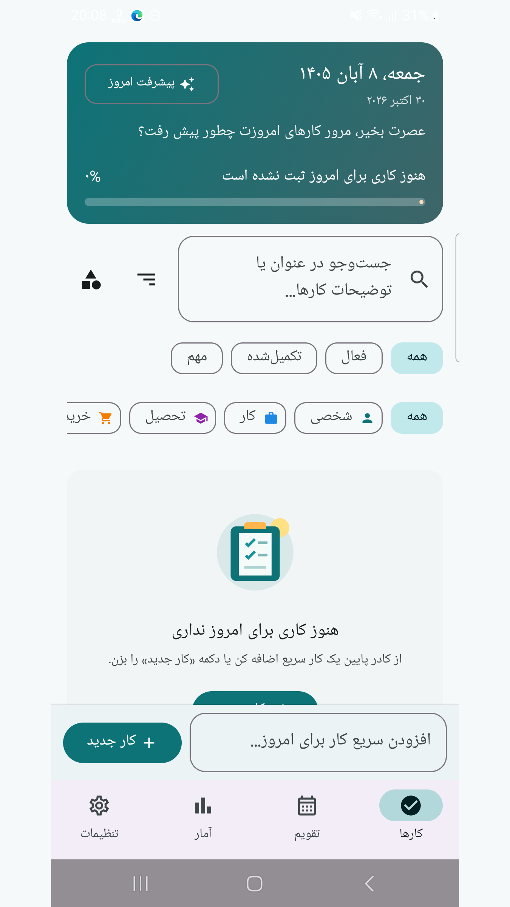
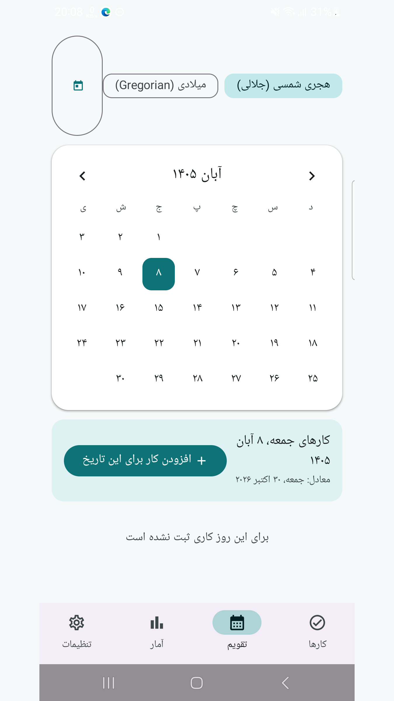
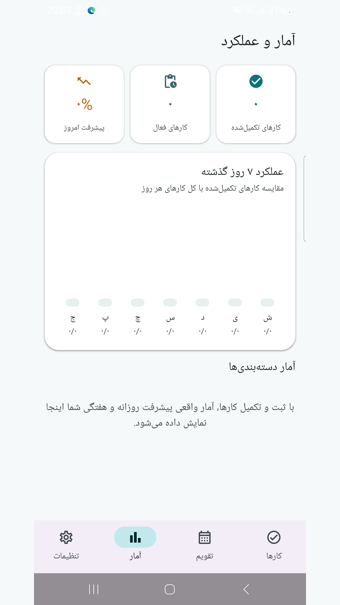
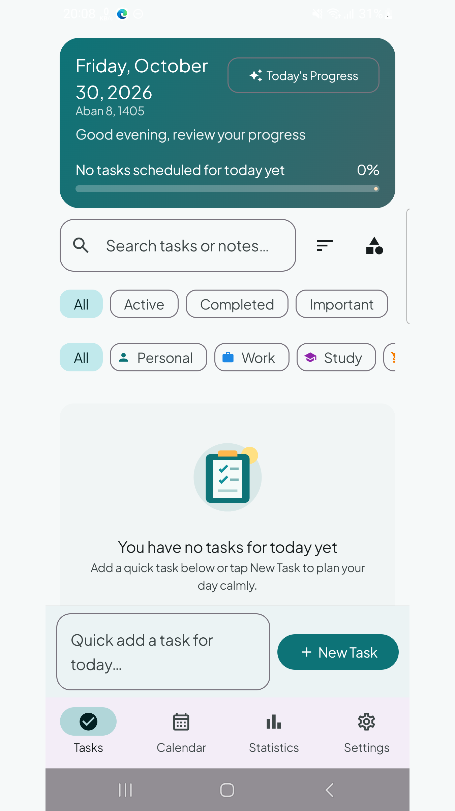
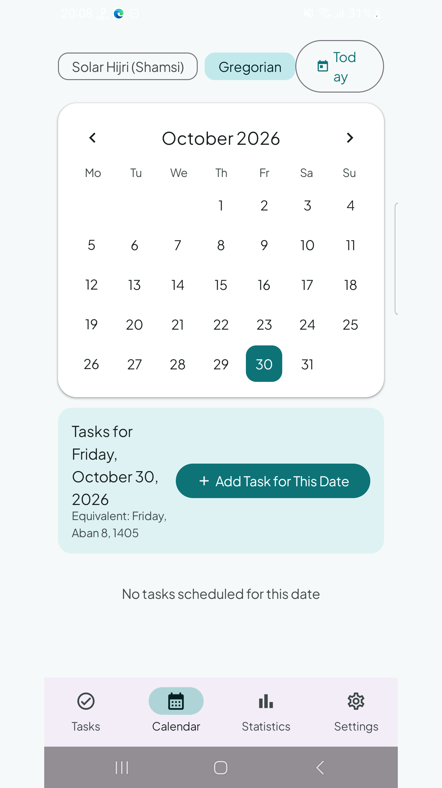
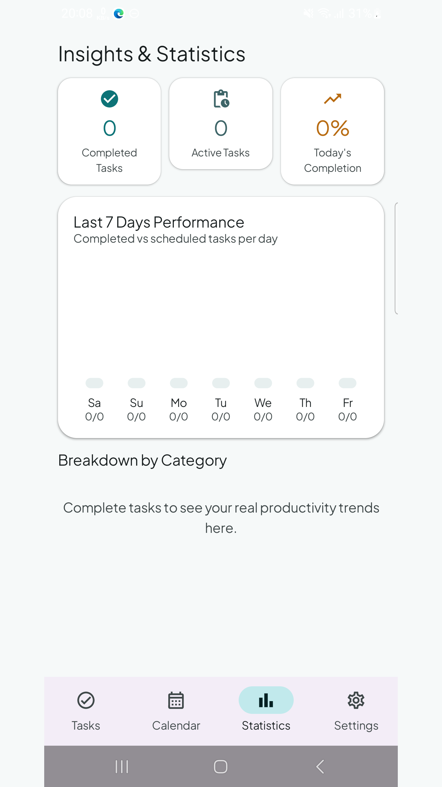

# Roozino | روزینو

[Download / دریافت APK](https://github.com/cinaasadpour-hash/roozino/releases/tag/v1.0.1)

Package: `com.sinatools.roozino` · Version: **1.0.1** · Version code: **2**

## فارسی

برنامه‌ریزی کارهای روزانه، تقویم شمسی و میلادی و یادآورها.

روزینو برای برنامه‌ریزی کارهای روزانه و پیگیری پیشرفت شما ساخته شده است. کار و زیرکار بسازید، دسته‌بندی، تاریخ، اولویت و تکرار را تعیین کنید و کارهای انجام‌شده را علامت بزنید. نمای تقویم و آمار به مرور برنامه و پیشرفت کمک می‌کنند.

رابط فارسی و انگلیسی، تقویم شمسی و میلادی و حالت روشن و تاریک در دسترس است. از تنظیمات می‌توانید پشتیبان بگیرید و فایل پشتیبان را بازیابی کنید.

نمایش یادآورها به مجوز اعلان و در موارد لازم اجازهٔ هشدار دقیق اندروید وابسته است. تنظیمات باتری گوشی نیز ممکن است روی زمان اعلان اثر بگذارد. در صورت استفاده از قابلیت اختیاری برنامه‌ریزی آنلاین، اطلاعات ارسالی را پیش از ادامه بررسی کنید.

## English

Plan daily tasks with Jalali and Gregorian calendars and reminders.

Roozino helps you plan daily tasks and review your progress. Create tasks and subtasks, assign categories, dates, priorities and recurrence, and mark work as completed. Calendar and statistics views help you review your schedule and activity.

Persian and English interfaces, Jalali and Gregorian calendars, and light and dark themes are available. Export a backup and restore it through Settings.

Reminders depend on Android notification permission and, where applicable, exact-alarm permission. Phone battery settings may affect notification timing. If you use the optional online planning feature, review the information you send before proceeding.

## Privacy / حریم خصوصی

See [Privacy / حریم خصوصی](PRIVACY.md). Store listing text in both languages is available in [store-listing](store-listing).

## Verification / بررسی

The signed APK was installed and launched on a Samsung Galaxy A32 with Android 13 on 2026-10-30, with existing app data preserved. The installed APK checksum matched the release file. Production Tapsell identifiers and the release certificate were checked in the APK. Detailed visual and functional coverage varies by app; this is not a guarantee of compatibility with every device or external service.

نسخهٔ امضاشده در ۳۰ اکتبر ۲۰۲۶ روی گوشی نصب و اجرا شد و اطلاعات قبلی حفظ شد. اثرانگشت نسخهٔ نصب‌شده با فایل انتشار برابر بود. نام بسته، امضا و شناسه‌های واقعی تپسل در APK بررسی شدند. محدودهٔ آزمون هر برنامه متفاوت است و سازگاری با همهٔ دستگاه‌ها و خدمات تضمین نمی‌شود.

## تصاویر برنامه

## Screenshots

